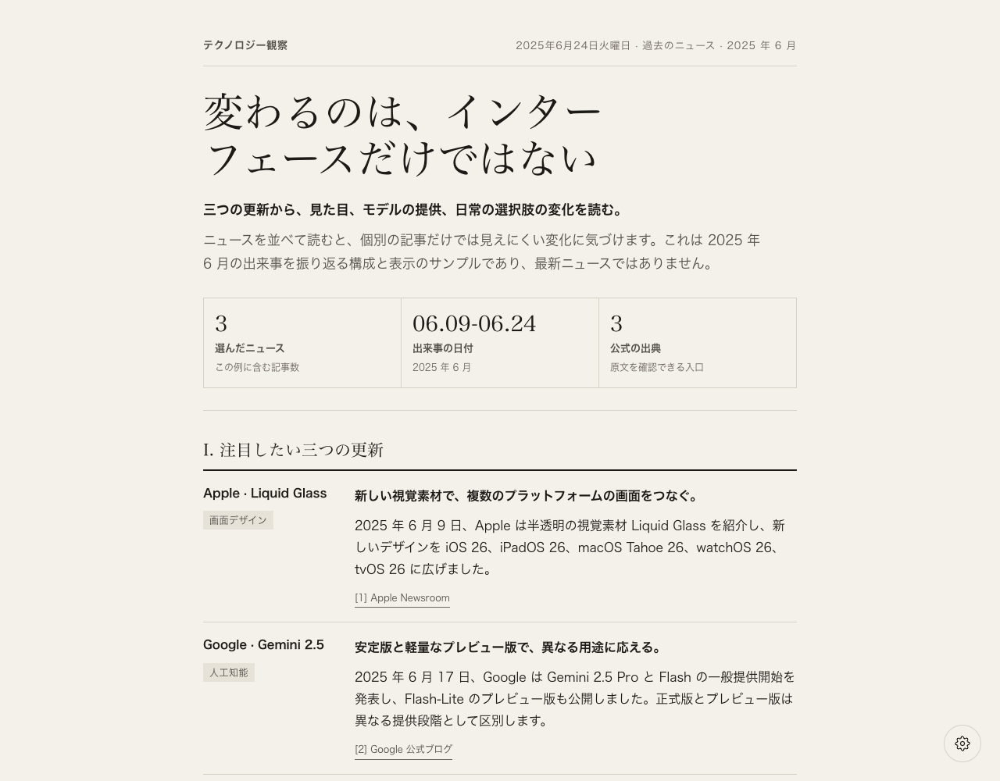
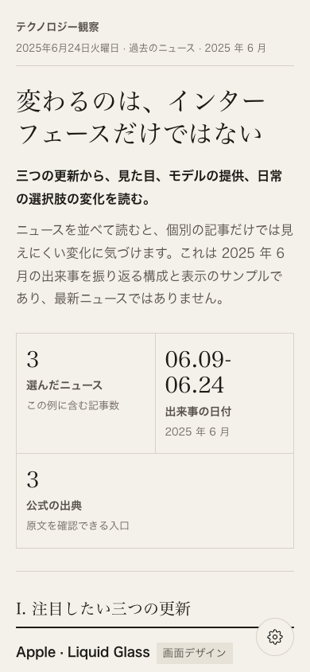
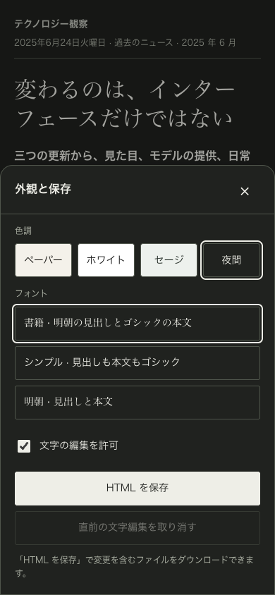
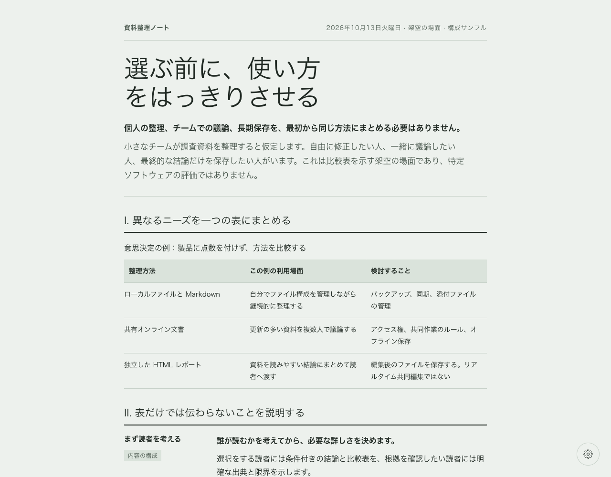

<p align="center">
  <picture>
    <source media="(max-width: 640px)" srcset="docs/images/readme-header-mobile.svg">
    
  </picture>
</p>

<h1 align="center">Dia スタイルレポート</h1>

<p align="center">
  一つの問いから、筋道の通ったレポートへ。<br>
  <sub>単一 HTML ファイル · 直接編集 · PC とスマートフォンで閲覧</sub>
</p>

<p align="center">
  <a href="README.md">English</a>
  &nbsp; / &nbsp;
  <a href="README.zh-CN.md">简体中文</a>
  &nbsp; / &nbsp;
  <a href="README.zh-TW.md">繁體中文</a>
  &nbsp; / &nbsp;
  <a href="README.ja.md"><strong>日本語</strong></a>
</p>

<p align="center">
  <a href="#表示例">表示例を見る</a>
  &nbsp; · &nbsp;
  <a href="#使い方">使い方</a>
  &nbsp; · &nbsp;
  <a href="SKILL.md">スキルの手順</a>
</p>

---

> **この skill の見た目は、Dia ブラウザーが自動で整理するドキュメントのスタイルを参考にしています。** 観察できるレイアウトや操作をもとに再実装した非公式プロジェクトであり、Dia の公式 skill や内部実装を書き出したものではありません。

一つの問い、数件のニュース、または資料の集まりを、ブラウザーでそのまま読んで編集・保存できる単一 HTML ファイルのレポートにまとめます。標準のデザインは、温かみのある紙色、セリフ体の見出し、細い罫線、控えめな段組みです。Dia のインストールは不要です。

## できること

- **内容の整理**：ニュースの要約、ツール比較、テーマ調査、資料の整理に適しています。まず結論を示し、その後に根拠と詳細を説明します。
- **内容に合わせた構成**：段落、分類した項目、リスト、比較表、出典リンクを使えます。信頼できる数値がある場合は指標欄も使えます。
- **レポートの直接編集**：本文をクリックして修正し、直前の文字編集を取り消せます。ブラウザー内の下書きと保存したファイルは別のものです。
- **外観の変更**：ペーパー・ホワイト・セージ・夜間の 4 色調と、書籍・シンプル・明朝の 3 種類のフォント設定を用意しています。
- **閲覧と持ち出し**：PC とスマートフォンに対応。現在の文章と外観を含む HTML を保存し、開き直して編集を続けられます。

skill が提供するのは、内容を整理するための指示、テンプレート、生成スクリプトです。**独立したニュース収集ツールや AI サービスではありません。** 調査と文章作成は利用する AI の機能に依存します。生成スクリプトは JSON を読み込むだけで、モデルを呼び出したり、ネットワークに接続したりしません。

## 表示例

以下は、このリポジトリで生成したページの実際のスクリーンショットであり、Dia 製品のスクリーンショットではありません。ニュースの例には **2025 年 6 月に起きた過去の出来事**を使用しています。表示を説明するためのもので、最新ニュースではありません。

編集画面は英語・簡体字中国語・繁体字中国語・日本語に対応しています。スクリーンショットはこの README と同じ言語で、日本語のレポートと編集画面を示しています。他の言語のレポート例は[言語](#言語)から確認できます。

### ニュースの要約

温かみのある紙色、結論から始まる導入、指標欄、左側のラベルと右側の説明からなるレイアウトです。



サンプル：[生成した HTML](examples/i18n/news-brief.ja.html) · [JSON データ](examples/i18n/news-brief.ja.json)

ニュースは [Apple Newsroom](https://www.apple.com/newsroom/2025/06/apple-introduces-a-delightful-and-elegant-new-software-design/)、[Google 公式ブログ](https://blog.google/products-and-platforms/products/gemini/gemini-2-5-model-family-expands/)、[Firefox リリースノート](https://www.firefox.com/en-US/firefox/140.0/releasenotes/)をもとに短くまとめています。レポートにも出典リンクと出来事の日付を残しています。

### スマートフォンでの閲覧と外観設定

幅の狭い画面では各項目が 1 列になります。右下の歯車で設定を開き、スマートフォンでは画面下部のパネルとして表示します。右の画像は夜間の色調です。

| スマートフォンでの閲覧 | 外観と保存 |
| --- | --- |
|  |  |

### 比較と表

同じテンプレートで比較のためのレポートも作成できます。この架空の例では 3 種類の資料管理方法を比較しています。特定製品の評価や、実際の購入判断のための助言ではありません。



サンプル：[生成した HTML](examples/i18n/report-comparison.ja.html) · [JSON データ](examples/i18n/report-comparison.ja.json)

スクリーンショットは Chromium 系ブラウザーで撮影しました。スマートフォン用画像は幅 390px の表示領域を模擬したもので、実機や Safari での検証ではありません。実際の字体は端末のシステムフォントによって変わります。

## 使い方

### 1. AI に skill を使わせる

ローカルファイルの読み取りと Python の実行ができる AI ツールで、まずリポジトリ直下の [SKILL.md](SKILL.md)を読むよう指示し、問い、資料、希望する出力を伝えます。

```text
このリポジトリの SKILL.md を読んでください。
渡したニュースのリンクを、日本語の技術ニュースレポートにまとめてください。
共通する主題を示してからテーマ別に整理し、出典と出来事の日付を残してください。
スマートフォンでも読みやすく、直接編集できる HTML を生成してください。
```

スキルを検出できる環境にインストール済みなら、Codex CLI／IDE 拡張では `$dia-style-report` で明示的に呼び出せます。スキル選択画面がある場合は、現在の表示名 `Dia Style Report` を選択してください。

```text
$dia-style-report これらの記事を日本語の調査レポートにまとめてください。
まず結論を示し、その後に根拠と限界を説明してください。
レイアウトを埋めるためだけに数値を作らないでください。
```

```text
$dia-style-report この 3 つのツールを日本語で比較してください。
利用場面、主な違い、移行コストを軸に表を作り、
どの条件ならどれが適しているかを説明して、HTML レポートを生成してください。
```

依頼にはレポートの出力言語を明記してください。指定した言語は、skill の説明、サンプル、出典の言語より優先されます。AI は本文をその言語で書き、編集画面も同じ言語に設定します。画面の言語を切り替えるだけでは本文は翻訳されません。既存レポートの編集では、変更を依頼しない限り元の言語を保持します。新規レポートで出力言語を指定しない場合は英語になります。

```text
$dia-style-report これらの英語資料を日本語の HTML レポートにまとめてください。
見出し、本文、表のラベル、編集画面は日本語にし、
固有名詞、出典 URL、出来事の日付は保持してください。
```

`SKILL.md` だけでなく、skill のディレクトリ全体をインストールしてください。[OpenAI の公式スキル文書](https://learn.chatgpt.com/docs/build-skills)では、Codex のユーザー単位の配置先は `~/.agents/skills/dia-style-report/`、プロジェクト単位の配置先は対象プロジェクト内の `.agents/skills/dia-style-report/` です。いずれかを選び、同名のディレクトリがある場合は上書きしないでください。他のツールでは、そのツールのスキル配置ルールに従ってください。

### 2. AI を使わずにサンプルを生成する

Python 3 が必要です。生成スクリプトは標準ライブラリのみを使います。以下のコマンドはリポジトリのルートで実行してください。

```bash
python3 scripts/render_report.py \
  --input examples/i18n/news-brief.ja.json \
  --output output/news-brief.html
```

生成した `output/news-brief.html` をブラウザーで開いてください。出力ディレクトリは自動で作成されます。

色調とフォントを変更する場合：

```bash
python3 scripts/render_report.py \
  --input examples/i18n/report-comparison.ja.json \
  --output output/report-comparison.html \
  --theme sage \
  --font modern
```

色調は `paper|white|sage|night`、フォントは `editorial|modern|serif` を指定できます。既存の出力ファイルは標準では上書きしません。置き換えることを確認した場合に限り `--force` を追加してください。独自の資料を使う場合は、[データ仕様](references/report-data.md)に従って JSON を作成します。

**レポートの言語を選ぶ**

新しいレポートの既定の言語は英語です。JSON の `language` を `en`、`zh-CN`、`zh-TW`、`ja` のいずれかに設定するか、`--language` で編集画面の言語を上書きします。ボタン、通知、日付、フォントの候補が切り替わります。**本文は自動翻訳されません**。AI に指定言語での執筆を依頼するか、翻訳済みの JSON を用意してください。

```bash
python3 scripts/render_report.py \
  --input examples/i18n/news-brief.ja.json \
  --output output/news-brief.ja.html \
  --language ja
```

### 3. 編集して保存する

1. HTML を開き、見出しや本文をクリックして文章を修正します。
2. 右下の歯車で色調やフォントを切り替えるか、文字編集を無効にします。
3. **HTML を保存** をクリックし、変更を含むファイルをダウンロードします。

ブラウザーは元の HTML ファイルを自動で書き換えません。下書きは現在のブラウザーのローカルストレージに依存し、ダウンロードして保存する代わりにはなりません。ローカルストレージが使えない場合も編集とダウンロードは可能です。

**現在の出力範囲**：HTML は直接保存できます。PDF はブラウザーの「印刷 → PDF として保存」を使います。改ページや背景はブラウザーの設定に依存します。専用の PDF／Markdown 出力ボタンはまだありません。

## 言語

リポジトリの既定の README は英語です。ページ上部の言語リンクで切り替えられます。どの言語版も同じ機能範囲、制限、使い方、声明を記載しています。

| 言語 | ファイル | 状態 |
| --- | --- | --- |
| English | [README.md](README.md) | メイン／既定 |
| 简体中文 | [README.zh-CN.md](README.zh-CN.md) | 簡体字中国語版 |
| 繁體中文 | [README.zh-TW.md](README.zh-TW.md) | 繁体字中国語版 |
| 日本語 | [README.ja.md](README.ja.md) | この言語版 |

各言語にニュースの要約、比較レポート、対応する JSON を用意しています。HTML はダウンロードするかローカルで開いてください。GitHub では HTML のソースが表示され、レポートは実行されません。`examples/` 直下は既定の英語版です。

| レポートの言語 | ニュースの要約 | 比較レポート |
| --- | --- | --- |
| English | [HTML](examples/news-brief.html) · [JSON](examples/news-brief.json) | [HTML](examples/report-comparison.html) · [JSON](examples/report-comparison.json) |
| 简体中文 | [HTML](examples/i18n/news-brief.zh-CN.html) · [JSON](examples/i18n/news-brief.zh-CN.json) | [HTML](examples/i18n/report-comparison.zh-CN.html) · [JSON](examples/i18n/report-comparison.zh-CN.json) |
| 繁體中文 | [HTML](examples/i18n/news-brief.zh-TW.html) · [JSON](examples/i18n/news-brief.zh-TW.json) | [HTML](examples/i18n/report-comparison.zh-TW.html) · [JSON](examples/i18n/report-comparison.zh-TW.json) |
| 日本語 | [HTML](examples/i18n/news-brief.ja.html) · [JSON](examples/i18n/news-brief.ja.json) | [HTML](examples/i18n/report-comparison.ja.html) · [JSON](examples/i18n/report-comparison.ja.json) |

## リポジトリの内容

| 場所 | 用途 |
| --- | --- |
| [SKILL.md](SKILL.md) | スキルの入口と内容を整理するための指示 |
| [assets/report-template.html](assets/report-template.html) | スタイル、編集、保存の処理を含むテンプレート |
| [assets/locales.json](assets/locales.json) | 各レポートに埋め込む共通の画面翻訳 |
| [scripts/render_report.py](scripts/render_report.py) | JSON の検証と HTML の生成 |
| [references/](references/) | データ仕様とデザイン資料 |
| [agents/openai.yaml](agents/openai.yaml) | 表示名と既定の呼び出し例 |
| [examples/](examples/) | 再現できるサンプルデータと生成済み HTML |
| [docs/images/](docs/images/) | 実際のページの画像と README のヘッダー素材 |
| [tests/](tests/) | 生成、言語、エスケープ、サンプルの回帰テスト (`python3 -m unittest discover -s tests -v`) |

## オープンソースとライセンスの状況

このリポジトリには、実装を確認できるよう、スキルの手順、テンプレート、生成スクリプト、サンプルを収録しています。

**ライセンスはまだ決定しておらず、`LICENSE` ファイルも含まれていません。** ソースが閲覧できることは、特定のオープンソースライセンスで利用を許諾したことを意味しません。この README 自体は複製、配布、商用利用を許諾するものではありません。正式にオープンソースとして公開する前に明確なライセンスを追加する必要があり、その後の利用許諾の範囲は `LICENSE` または権利者による明示的な許諾に従います。

ニュースの出典やその他の第三者の素材に関する権利は、このプロジェクトのライセンスによって移転するものではなく、プロジェクトが第三者に代わって許諾できるものでもありません。

## 権利への配慮と非公式プロジェクトに関する声明

- **デザインの参考元と公式の関係は別です**：Dia の名称は見た目の参考元を示すためだけに使っています。このプロジェクトと Dia に公式の提携、所属、推奨関係はなく、Dia の公式製品として扱わないでください。
- **第三者の権利を主張しません**：Dia や他のブランドの名称、商標、独自コード、画像などの権利は各権利者に帰属します。このプロジェクトはそれらの利用を許諾するものではありません。
- **表示例の出典を明確にします**：README の画像はこのプロジェクトで生成したページです。ニュースは独自にまとめた短い要約と出典リンクで示し、記事全文や第三者の挿絵を転載しません。
- **公開前に素材と事実を確認してください**：入力資料、引用、生成内容を確認し、必要な許諾を取得してください。プライバシーを侵害せず、例や編集上の判断を事実や公式声明として扱わないでください。
- **権利者からの連絡を尊重します**：権利上の問題があると考える場合は、該当箇所と権利を示す資料を管理者または公開先に提供してください。確認のうえ、修正や削除を検討できます。

この声明は実際の許諾確認に代わるものではなく、権利侵害が一切起きないことを保証するものでもありません。
