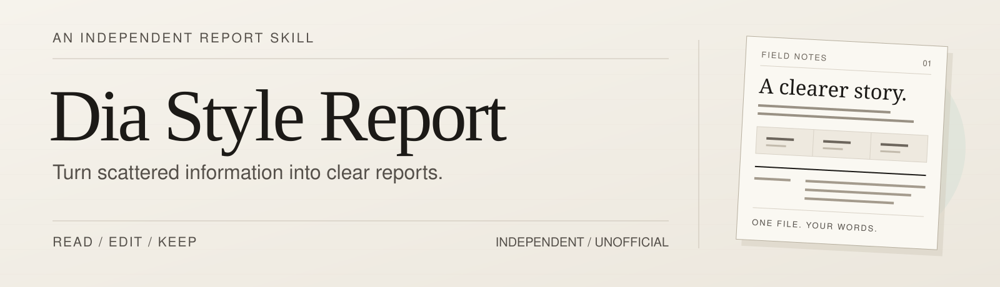
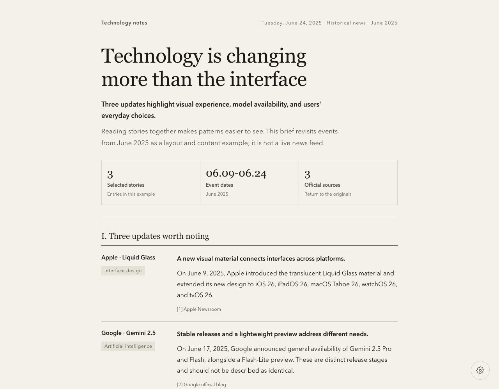
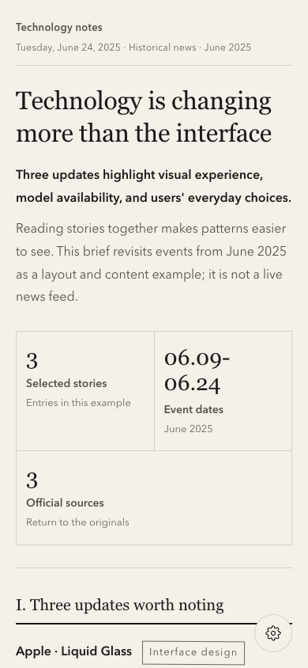
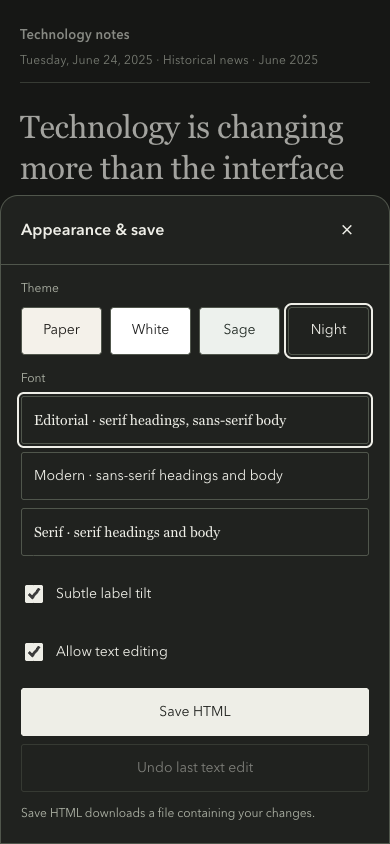
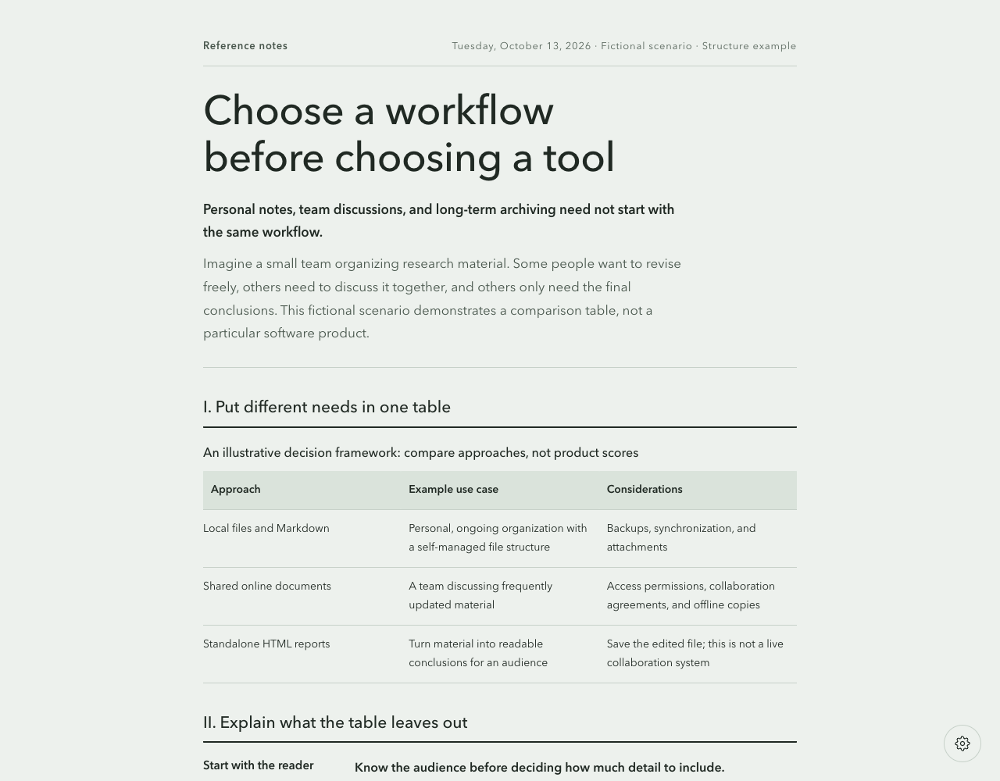

<p align="center">
  <picture>
    <source media="(max-width: 640px)" srcset="docs/images/readme-header-mobile.svg">
    
  </picture>
</p>

<h1 align="center">Dia Style Report</h1>

<p align="center">
  Turn a question into a clear report.<br>
  <sub>Single-file HTML · Direct editing · Desktop and mobile reading</sub>
</p>

<p align="center">
  <a href="README.md"><strong>English</strong></a>
  &nbsp; / &nbsp;
  <a href="README.zh-CN.md">简体中文</a>
  &nbsp; / &nbsp;
  <a href="README.zh-TW.md">繁體中文</a>
  &nbsp; / &nbsp;
  <a href="README.ja.md">日本語</a>
</p>

<p align="center">
  <a href="#examples">See examples</a>
  &nbsp; · &nbsp;
  <a href="#usage">Get started</a>
  &nbsp; · &nbsp;
  <a href="SKILL.md">Skill instructions</a>
</p>

---

> **This skill's visual style is inspired by the automatically organized documents in the Dia browser.** It is an unofficial reimplementation based on observable layout and interactions, not an official Dia skill or an export of Dia's internal implementation.

Turn a question, a few news stories, or a collection of notes into a single-file HTML report that you can read, edit, and save directly in a browser. The default design uses warm-paper colors, serif headings, fine rules, and restrained columns. Dia is not required.

## What it does

- **Organizes content**: suitable for news briefs, tool comparisons, topic research, and reference summaries. Start with the conclusion, then explain the evidence and details.
- **Chooses layouts to fit the content**: supports paragraphs, categorized entries, lists, comparison tables, source links, and a metrics strip when reliable data is available.
- **Lets you edit reports directly**: click text to change it and undo the last text edit. Browser drafts and saved files are separate.
- **Offers appearance presets**: four color themes—Paper, White, Sage, and Night—and three font presets: Editorial, Modern, and Serif.
- **Makes reports portable**: read on desktop or mobile, save an HTML file containing the current text and appearance, and reopen it to continue editing.

The skill supplies content-organization guidance, a template, and a renderer. **It is not a standalone news crawler or AI service.** Research and writing depend on the host AI's capabilities. The renderer only reads JSON; it does not call a model or access the network.

## Examples

These are actual screenshots of pages generated by this repository, not screenshots of Dia. The news example uses **historical events from June 2025** to demonstrate the layout; it is not a live news feed.

The editor supports English, Simplified Chinese, Traditional Chinese, and Japanese. Screenshots match this README's language and show English reports and controls; other report languages are linked in [Languages](#languages).

### News brief

Warm-paper colors, a conclusion-first introduction, a metrics strip, and entries with labels on the left and explanations on the right.



Example: [Generated HTML](examples/news-brief.html) · [JSON data](examples/news-brief.json)

The stories are short summaries based on [Apple Newsroom](https://www.apple.com/newsroom/2025/06/apple-introduces-a-delightful-and-elegant-new-software-design/), the [official Google blog](https://blog.google/products-and-platforms/products/gemini/gemini-2-5-model-family-expands/), and the [Firefox release notes](https://www.firefox.com/en-US/firefox/140.0/releasenotes/). The report also retains the source links and event dates.

### Mobile reading and appearance settings

Entries become single-column on narrow screens. The bottom-right gear opens the settings, shown as a bottom sheet on mobile. The right-hand screenshot shows the Night theme.

| Mobile reading | Appearance and saving |
| --- | --- |
|  |  |

### Comparisons and tables

The same template can also organize comparison questions. This fictional scenario compares three approaches to managing reference material; it does not evaluate particular products or provide purchasing advice.



Example: [Generated HTML](examples/report-comparison.html) · [JSON data](examples/report-comparison.json)

The screenshots were captured in a Chromium-based browser. The mobile images use a simulated 390px viewport, not a physical phone or a Safari test. System fonts vary by device.

## Usage

### 1. Ask an AI to use the skill

In an AI tool that can read local files and run Python, ask it to read [SKILL.md](SKILL.md) at the repository root, then describe your question, source material, and desired output:

```text
Read SKILL.md in the current repository.
Turn the news links I provide into an English technology brief.
Identify a common thread, group the stories by topic, and retain
the sources and event dates. Generate editable, mobile-friendly HTML.
```

If the skill is installed in a host that supports skill discovery, invoke it explicitly with `$dia-style-report` in Codex CLI or the IDE extension. In interfaces with a skill picker, select the skill's current display name, `Dia Style Report`.

```text
$dia-style-report Turn these articles into an English research report.
Start with the conclusion, then explain the evidence and limitations.
Do not invent numbers merely to fill the layout.
```

```text
$dia-style-report Compare these three tools in English.
Organize a table around use cases, key differences, and migration costs.
Explain which conditions favor each choice, then generate an HTML report.
```

Specify the report's output language in your request. It takes precedence over the language of the skill instructions, examples, or sources. The AI writes the report text in that language and sets a matching editor locale; selecting a locale alone does not translate the text. When editing an existing report, its language is retained unless you request a change. New reports with no requested output language default to English.

```text
$dia-style-report Read these Japanese articles and write an English HTML report.
Use English for the headings, body text, table labels, and editor controls;
preserve proper names, source URLs, and event dates.
```

Install the complete skill directory, not just `SKILL.md`. According to the [official OpenAI skill documentation](https://learn.chatgpt.com/docs/build-skills), the user-level location for Codex is `~/.agents/skills/dia-style-report/`, and the project-level location is `.agents/skills/dia-style-report/` inside the target project. Choose one; do not overwrite an existing directory with the same name. Other tools use their own skill-directory conventions.

### 2. Generate an example without AI

You need Python 3. The renderer uses only the standard library. Run these commands from the repository root:

```bash
python3 scripts/render_report.py \
  --input examples/news-brief.json \
  --output output/news-brief.html
```

Open the generated `output/news-brief.html` in a browser. The output directory is created automatically.

Choose a different theme and font:

```bash
python3 scripts/render_report.py \
  --input examples/report-comparison.json \
  --output output/report-comparison.html \
  --theme sage \
  --font modern
```

Theme options are `paper|white|sage|night`; font options are `editorial|modern|serif`. Existing output files are not overwritten by default. Add `--force` only when you intend to replace a file. Follow the [data specification](references/report-data.md) to prepare your own JSON.

**Choose the report language**

New reports default to English. Set `language` to `en`, `zh-CN`, `zh-TW`, or `ja` in JSON, or add `--language` to override the editor language. Controls, status messages, dates, and font stacks follow that choice. **This does not translate supplied prose**: ask the AI to write in the requested language, or use translated JSON.

```bash
python3 scripts/render_report.py \
  --input examples/i18n/news-brief.ja.json \
  --output output/news-brief.ja.html \
  --language ja
```

### 3. Edit and save

1. Open the HTML and click a heading or body text to edit it.
2. Click the bottom-right gear to change the theme or font, or disable text editing.
3. Click **Save HTML** to download a file containing your changes.

The browser does not write changes back to the original HTML file automatically. Drafts depend on local storage in the current browser and are not a substitute for saving a downloaded copy. Editing and downloading remain available when local storage is unavailable.

**Current export limits**: HTML can be saved directly. For PDF, use the browser's **Print → Save as PDF**; page breaks and backgrounds depend on browser settings. There are no dedicated PDF or Markdown export buttons yet.

## Languages

English is the repository's default README. Use the language links at the top to switch versions. All versions retain the same capabilities, limitations, usage steps, and notices.

| Language | File | Status |
| --- | --- | --- |
| English | [README.md](README.md) | Primary / default |
| 简体中文 | [README.zh-CN.md](README.zh-CN.md) | Simplified Chinese |
| 繁體中文 | [README.zh-TW.md](README.zh-TW.md) | Traditional Chinese |
| 日本語 | [README.ja.md](README.ja.md) | Japanese |

Each language has a news brief and a comparison report with matching JSON. Open the HTML locally or download it; GitHub displays HTML source rather than running the report. English is the default at `examples/`.

| Report language | News brief | Comparison |
| --- | --- | --- |
| English | [HTML](examples/news-brief.html) · [JSON](examples/news-brief.json) | [HTML](examples/report-comparison.html) · [JSON](examples/report-comparison.json) |
| 简体中文 | [HTML](examples/i18n/news-brief.zh-CN.html) · [JSON](examples/i18n/news-brief.zh-CN.json) | [HTML](examples/i18n/report-comparison.zh-CN.html) · [JSON](examples/i18n/report-comparison.zh-CN.json) |
| 繁體中文 | [HTML](examples/i18n/news-brief.zh-TW.html) · [JSON](examples/i18n/news-brief.zh-TW.json) | [HTML](examples/i18n/report-comparison.zh-TW.html) · [JSON](examples/i18n/report-comparison.zh-TW.json) |
| 日本語 | [HTML](examples/i18n/news-brief.ja.html) · [JSON](examples/i18n/news-brief.ja.json) | [HTML](examples/i18n/report-comparison.ja.html) · [JSON](examples/i18n/report-comparison.ja.json) |

## Repository contents

| Location | Purpose |
| --- | --- |
| [SKILL.md](SKILL.md) | Skill entry point and content-organization guidance |
| [assets/report-template.html](assets/report-template.html) | Template with inline styles, editing, and saving interactions |
| [assets/locales.json](assets/locales.json) | Shared UI translations embedded in every generated report |
| [scripts/render_report.py](scripts/render_report.py) | JSON validation and HTML rendering |
| [references/](references/) | Data specification and design reference |
| [agents/openai.yaml](agents/openai.yaml) | Display name and default invocation prompt |
| [examples/](examples/) | Reproducible example data and generated HTML |
| [docs/images/](docs/images/) | Actual page screenshots and README header artwork |
| [tests/](tests/) | Renderer, locale, escaping, and example regression tests (`python3 -m unittest discover -s tests -v`) |

## Open-source and licensing status

This repository provides inspectable skill instructions, templates, a renderer, and examples so you can understand the implementation.

**A license has not yet been selected, and the repository does not include a `LICENSE` file.** Visible source code does not mean it has been licensed under a particular open-source license. This README does not itself grant permission to copy, distribute, or use the material commercially. A clear license must be added before a formal open-source release; the scope of any subsequent permission is governed by that `LICENSE` or express permission from the rights holder.

Rights in news sources and other third-party material do not transfer under this project's license and are not rights this project can grant on someone else's behalf.

## Rights and unofficial-project notice

- **Design inspiration is not an official relationship**: the Dia name identifies the visual reference only. This project has no official affiliation, partnership, or endorsement from Dia and must not be presented as an official Dia product.
- **No claim to third-party rights**: names, trademarks, proprietary code, images, and other assets belonging to Dia or other brands remain the property of their respective rights holders. This project does not grant permission to use those assets.
- **Clearly sourced demonstrations**: README screenshots show pages generated by this project. News is presented as short, independently written summaries with source links, not reproductions of entire articles or third-party illustrations.
- **Check material and facts before publishing**: users should review their input, references, and generated content, obtain any necessary permission, avoid exposing private information, and not mislabel examples or editorial judgments as facts or official statements.
- **Respect rights-holder feedback**: if you believe specific content raises a rights issue, provide its location and evidence of ownership to the maintainer or publishing platform so it can be reviewed and corrected or removed.

This notice does not replace an actual permissions review and is not a guarantee that no infringement can occur.
