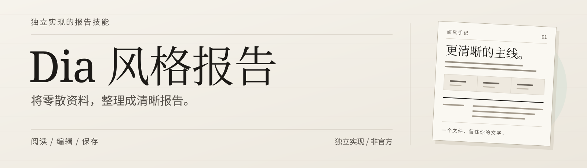
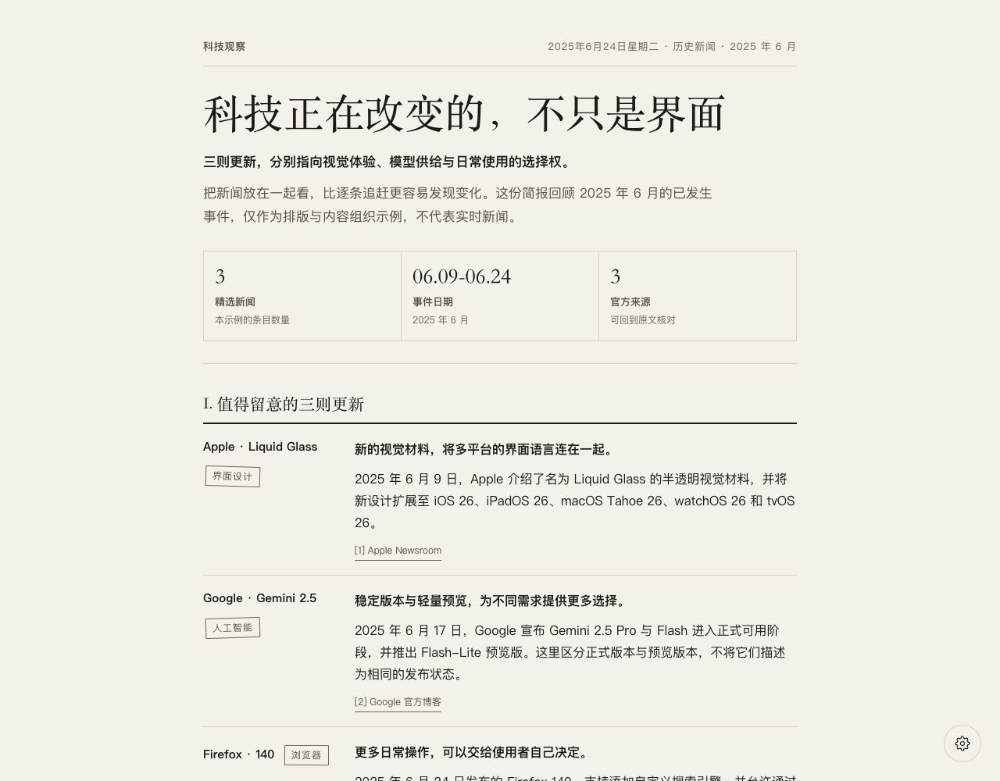
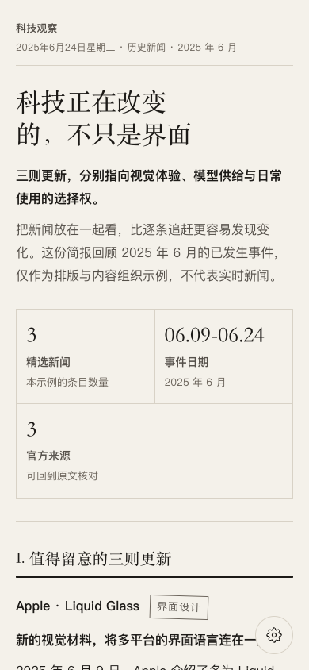
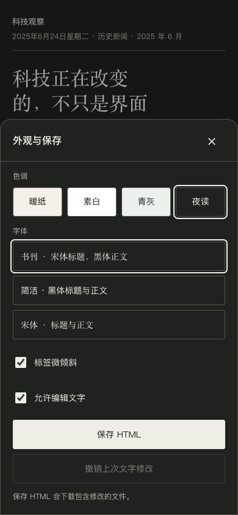
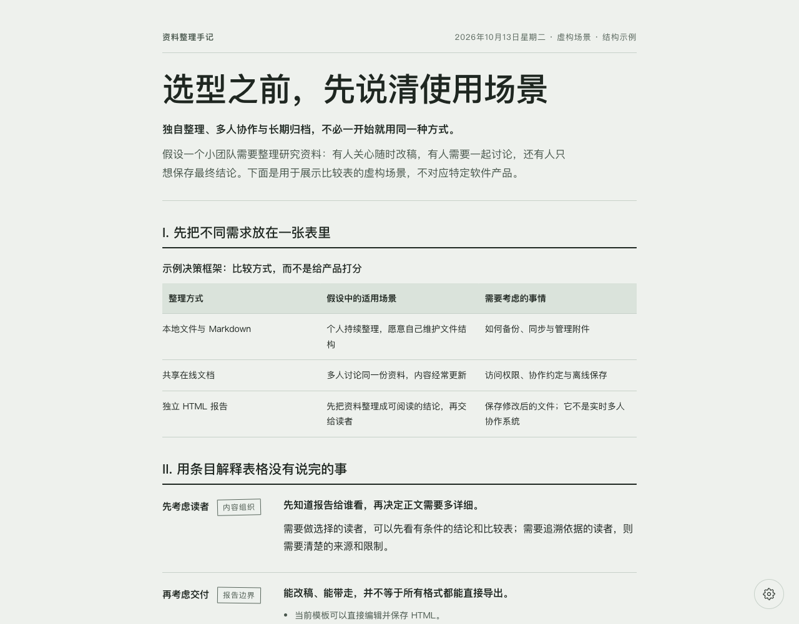
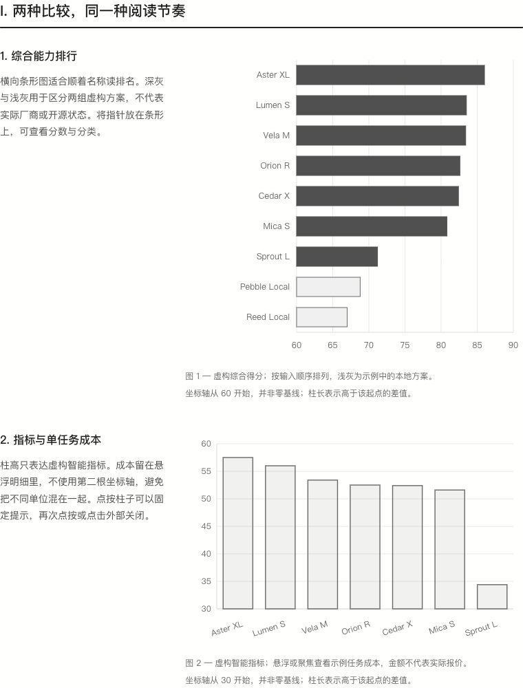
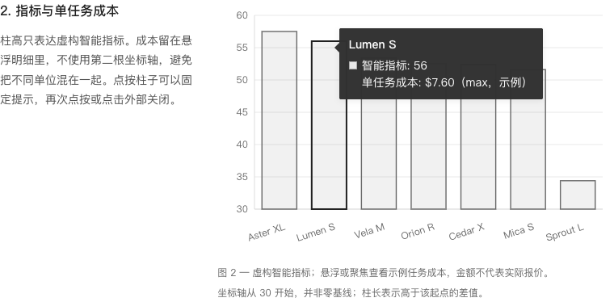
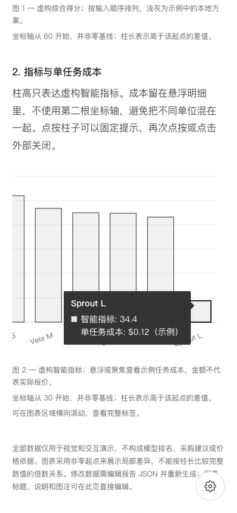

<p align="center">
  <picture>
    <source media="(max-width: 640px)" srcset="docs/images/zh-CN/readme-header-mobile.svg">
    
  </picture>
</p>

<h1 align="center">Dia 风格报告</h1>

<p align="center">
  从一个问题，到一份有主线的报告。<br>
  <sub>单文件 HTML · 直接编辑 · 桌面与手机阅读</sub>
</p>

<p align="center">
  <a href="README.md">English</a>
  &nbsp; / &nbsp;
  <a href="README.zh-CN.md"><strong>简体中文</strong></a>
  &nbsp; / &nbsp;
  <a href="README.zh-TW.md">繁體中文</a>
  &nbsp; / &nbsp;
  <a href="README.ja.md">日本語</a>
</p>

<p align="center">
  <a href="#看看效果">查看效果</a>
  &nbsp; · &nbsp;
  <a href="#怎么使用">开始使用</a>
  &nbsp; · &nbsp;
  <a href="SKILL.md">技能入口</a>
</p>

---

> **本 skill 的视觉风格仿照 Dia 浏览器中自动整理文档的风格。** 它是参考可观察的排版与交互重新实现的非官方项目，不是 Dia 的官方 skill，也不是其内部实现的导出。

将一个问题、几条新闻或一组资料，整理成一份可直接在浏览器中阅读、改稿和保存的单文件 HTML 报告。默认采用暖纸色背景、衬线标题、细分隔线和克制的分栏布局；不需要安装 Dia。

## 能做什么

- **整理内容**：适合新闻简报、工具选型、主题研究和资料归纳，先给结论，再展开依据与细节。
- **按内容选择版式**：支持段落、分类条目、列表、比较表、来源链接，以及有数据依据时使用的指标条。
- **交互式图表**：横向排名条形图与描边竖向柱形图，支持悬停、手机点按和键盘查看明细；数据由 JSON 生成，不提供网页内数据编辑面板。
- **直接编辑报告**：点击正文即可改字，可撤销上次文字修改；浏览器草稿与磁盘文件是两回事。
- **调整外观**：提供暖纸、素白、青灰、夜读四种色调，以及书刊、简洁、宋体三组字体预设；细描边分类标签支持稳定、可关闭的轻微倾斜。
- **阅读与带走**：适配桌面和手机，保存为包含当前文字与外观的 HTML，重新打开后可继续编辑。

skill 负责提供内容组织规则、模板和生成脚本，**不是独立的新闻爬虫或 AI 服务**。检索与写作依赖宿主 AI 的能力；生成器本身只读取 JSON，不调用模型，也不联网。

## 看看效果

以下图片均为本仓库生成页面的实际截图，不是 Dia 产品截图。新闻示例选用 **2025 年 6 月的历史事件**，用于展示效果，不代表实时新闻。

编辑器现已支持英文、简体中文、繁体中文和日文。截图与本页语言一致，展示简体中文报告及编辑器界面；其他语言的报告示例见[语言版本](#语言版本)。

### 新闻简报

暖纸色、结论开场、指标条和左侧标签／右侧正文的布局。



示例：[HTML 成品](examples/i18n/news-brief.zh-CN.html) · [JSON 数据](examples/i18n/news-brief.zh-CN.json)

新闻内容经过简短概括，原始来源为 [Apple Newsroom](https://www.apple.com/newsroom/2025/06/apple-introduces-a-delightful-and-elegant-new-software-design/)、[Google 官方博客](https://blog.google/products-and-platforms/products/gemini/gemini-2-5-model-family-expands/)和 [Firefox 发布说明](https://www.firefox.com/en-US/firefox/140.0/releasenotes/)，具体链接与事件日期也保留在报告里。

### 手机阅读与外观设置

窄屏条目改为单列；右下角齿轮打开设置，手机上以底部面板呈现。右图展示夜读色调。

| 手机阅读 | 外观与保存 |
| --- | --- |
|  |  |

### 资料选型与比较表

同一套模板也能组织选型问题。这份虚构场景示例比较三种资料管理方式，不对应特定产品，也不是实际采购建议。



示例：[HTML 成品](examples/i18n/report-comparison.zh-CN.html) · [JSON 数据](examples/i18n/report-comparison.zh-CN.json)

截图使用 Chromium 内核浏览器生成；手机图为 390px 视口模拟，不等同于真实手机或 Safari 验证。系统字体会随设备变化。

### 交互式条形图

桌面采用左侧说明、右侧图表；手机改为上下排列。鼠标悬停或键盘聚焦可展开深色明细框；点按、Enter 或空格可固定或关闭，Escape 或点击外部可关闭。密集标签只在图表区域横向滚动，不撑宽整页。



指向柱子即可显示对象名称、精确指标和附加的任务成本，不需要增加第二根坐标轴：



<details>
<summary>查看手机效果：点按展示明细，只在图表内横向滚动</summary>



这是 390px 视口模拟，不等同于真实手机或 Safari 验证。

</details>

样例：[交互 HTML](examples/chart-comparison.zh-CN.html) · [JSON 数据](examples/chart-comparison.zh-CN.json)。**全部名称、分数及成本均为虚构，仅演示样式与交互，不是已核验的模型排名或价格。** README 图片为静态截图；请在本地打开 HTML 体验交互。

```bash
python3 scripts/render_report.py \
  --input examples/chart-comparison.zh-CN.json \
  --output output/chart-comparison.zh-CN.html \
  --theme white --font modern
```

图表标题、说明和图注可直接改字；数值、标签与悬浮明细需修改 JSON 后重新生成。非零坐标起点会明确提示。保存 HTML 保留完整交互并可离线打开；打印保留静态图表，不包含仅在悬浮框中显示的明细。

## 怎么使用

### 1. 让 AI 使用这个 skill

在可以读取本地文件并运行 Python 的 AI 工具中，先让它读取仓库根目录的 [SKILL.md](SKILL.md)，再说明你的问题、资料和输出要求：

```text
请读取当前仓库的 SKILL.md，
把我提供的新闻链接整理成一份简体中文科技简报。
先提炼共同主线，再按主题分组，保留来源与事件日期，
生成适合手机阅读、可以直接编辑的 HTML。
```

若已将 skill 安装到支持技能发现的宿主，Codex CLI／IDE 可以用 `$dia-style-report` 显式调用；支持技能选择器的界面也可以直接选择 `Dia Style Report`。

```text
$dia-style-report 用简体中文把这几篇文章整理成一份主题研究报告，
先给结论，再列依据与限制；不要为了版面编造数字。
```

```text
$dia-style-report 用简体中文比较这三个工具：
按使用场景、主要差异和迁移成本组织表格，
明确什么条件下适合选哪个，最后生成 HTML 报告。
```

请在请求中明确报告的输出语言。指定语言优先于 skill 说明、示例和来源资料的语言；AI 应以该语言撰写正文，并设置对应的编辑器语言，不能只切换界面而不翻译内容。修改已有报告时，未要求换语言就保留原语言；新报告未指定输出语言时默认英文。

```text
$dia-style-report 把这些英文资料整理成简体中文 HTML 报告。
标题、正文、表格标签和编辑器界面使用简体中文，
保留专有名称、来源链接与事件日期。
```

安装时保留完整目录，不要只复制 `SKILL.md`。按 [OpenAI 官方技能文档](https://learn.chatgpt.com/docs/build-skills)，Codex 的用户级位置是 `~/.agents/skills/dia-style-report/`，项目级位置是目标项目的 `.agents/skills/dia-style-report/`。两者选其一；已有同名目录时不要直接覆盖。其他工具按各自的技能目录约定安装。

### 2. 不用 AI，直接生成示例

需要 Python 3，生成器仅使用标准库。以下命令在仓库根目录执行：

```bash
python3 scripts/render_report.py \
  --input examples/i18n/news-brief.zh-CN.json \
  --output output/news-brief.html
```

用浏览器打开生成的 `output/news-brief.html` 即可。输出目录会自动创建。

更换色调与字体：

```bash
python3 scripts/render_report.py \
  --input examples/i18n/report-comparison.zh-CN.json \
  --output output/report-comparison.html \
  --theme sage \
  --font modern
```

色调参数为 `paper|white|sage|night`，字体参数为 `editorial|modern|serif`。默认拒绝覆盖同名文件；确认需要覆盖时才加 `--force`。自己的资料可以按 [数据约定](references/report-data.md)填写 JSON。

**分类小标签**

标签默认采用细描边和轻微倾斜。可在齿轮菜单关闭“标签微倾斜”以水平显示，或生成时传入 `--badge-tilt off`（默认为 `on`）。编辑文字、撤销、切换色调或字体、刷新及导出重开都不会重新分配角度。长标签完整换行、不截断，并自动保持水平。草稿与保存的 HTML 保留开关选择，打印也遵循该选择。旧 HTML 不会自动升级；需要保留当前文字与外观，使用新模板重新生成后才获得此开关。

**选择报告语言**

新报告默认英文。在 JSON 中将 `language` 设为 `en`、`zh-CN`、`zh-TW` 或 `ja`，也可通过 `--language` 覆盖编辑器语言。按钮、提示、日期和字体栈随语言适配。**这不会自动翻译正文**：请让 AI 按指定语言写作，或提供已翻译的 JSON。

```bash
python3 scripts/render_report.py \
  --input examples/i18n/news-brief.zh-CN.json \
  --output output/news-brief.zh-CN.html \
  --language zh-CN
```

### 3. 修改并保存

1. 打开 HTML，点击标题或正文改字。
2. 点击右下角齿轮，切换色调、字体、标签微倾斜，或关闭文字编辑。
3. 点击“保存 HTML”，下载包含当前修改的文件。

浏览器不会自动写回原 HTML。草稿依赖当前浏览器的本地存储，不能代替下载保存；存储不可用时仍可编辑和下载。

**当前导出边界**：直接保存 HTML；PDF 可通过浏览器“打印 → 保存为 PDF”，分页和背景受浏览器设置影响；尚无专门的 PDF 或 Markdown 导出按钮。

## 语言版本

英文为仓库默认首页；页首语言导航可切换到其他版本。各版本保留相同的能力边界、使用步骤与声明。

| 语言 | 文件位置 | 状态 |
| --- | --- | --- |
| English | [README.md](README.md) | 默认版本 |
| 简体中文 | [README.zh-CN.md](README.zh-CN.md) | 当前版本 |
| 繁體中文 | [README.zh-TW.md](README.zh-TW.md) | 繁体中文版本 |
| 日本語 | [README.ja.md](README.ja.md) | 日本语版本 |

每种语言均提供新闻简报、比较报告、交互图表示例和对应 JSON。请下载 HTML 或在本地打开；GitHub 展示的是 HTML 源码，不会直接运行报告。英文示例使用不带语言后缀的文件名。

| 报告语言 | 新闻简报 | 比较报告 | 交互图表 |
| --- | --- | --- | --- |
| English | [HTML](examples/news-brief.html) · [JSON](examples/news-brief.json) | [HTML](examples/report-comparison.html) · [JSON](examples/report-comparison.json) | [HTML](examples/chart-comparison.html) · [JSON](examples/chart-comparison.json) |
| 简体中文 | [HTML](examples/i18n/news-brief.zh-CN.html) · [JSON](examples/i18n/news-brief.zh-CN.json) | [HTML](examples/i18n/report-comparison.zh-CN.html) · [JSON](examples/i18n/report-comparison.zh-CN.json) | [HTML](examples/chart-comparison.zh-CN.html) · [JSON](examples/chart-comparison.zh-CN.json) |
| 繁體中文 | [HTML](examples/i18n/news-brief.zh-TW.html) · [JSON](examples/i18n/news-brief.zh-TW.json) | [HTML](examples/i18n/report-comparison.zh-TW.html) · [JSON](examples/i18n/report-comparison.zh-TW.json) | [HTML](examples/i18n/chart-comparison.zh-TW.html) · [JSON](examples/i18n/chart-comparison.zh-TW.json) |
| 日本語 | [HTML](examples/i18n/news-brief.ja.html) · [JSON](examples/i18n/news-brief.ja.json) | [HTML](examples/i18n/report-comparison.ja.html) · [JSON](examples/i18n/report-comparison.ja.json) | [HTML](examples/i18n/chart-comparison.ja.html) · [JSON](examples/i18n/chart-comparison.ja.json) |

## 仓库内容

| 位置 | 用途 |
| --- | --- |
| [SKILL.md](SKILL.md) | 技能入口与内容组织规则 |
| [assets/report-template.html](assets/report-template.html) | 内联样式、编辑与保存交互模板 |
| [assets/locales.json](assets/locales.json) | 嵌入每份报告的共享界面翻译 |
| [scripts/render_report.py](scripts/render_report.py) | JSON 校验与 HTML 生成器 |
| [references/](references/) | 数据约定与设计参考 |
| [agents/openai.yaml](agents/openai.yaml) | 显示名称与默认调用提示 |
| [examples/](examples/) | 可复现的示例数据与 HTML 成品 |
| [docs/images/](docs/images/) | README 使用的实际页面截图 |
| [tests/](tests/) | 既有生成器与界面语言回归测试 |

## 开源与授权说明

本仓库提供可检查的技能说明、模板、生成脚本和示例，便于了解实现方式。

**当前许可证待确定，仓库尚未附带 `LICENSE`。** 源码可见不代表已经按某项开源许可证授权；本 README 不擅自授予复制、分发或商用许可。正式开源发布前需补充明确的许可证，后续授权范围以 `LICENSE` 或权利人的明确授权为准。

新闻来源及其他第三方内容的权利不因本项目的许可证而转移，也不属于本项目可以代为授权的范围。

## 防侵权与非官方声明

- **设计参考不等于官方关系**：Dia 名称仅用于说明风格来源；本项目与 Dia 无官方合作、隶属或背书关系，不应包装成其官方产品。
- **不主张第三方权利**：Dia 及文中其他品牌的名称、商标、专有代码、图片等权利归相应权利人所有；本项目不提供这些资源的使用授权。
- **展示内容有明确来源**：README 截图来自本项目生成的页面；新闻以自行概括的短文本和来源链接展示，不转载新闻全文或第三方配图。
- **发布前检查素材与事实**：使用者应核对输入材料、引用和生成内容，取得必要授权，避免泄露隐私或将示例、编辑判断误标为事实及官方声明。
- **尊重权利人反馈**：如认为某项内容涉及权利问题，请向项目维护者或发布平台提供具体位置与权属依据，以便核查并修正或移除。

本声明不能替代实际的授权审查，也不构成对“绝无侵权”的保证。
