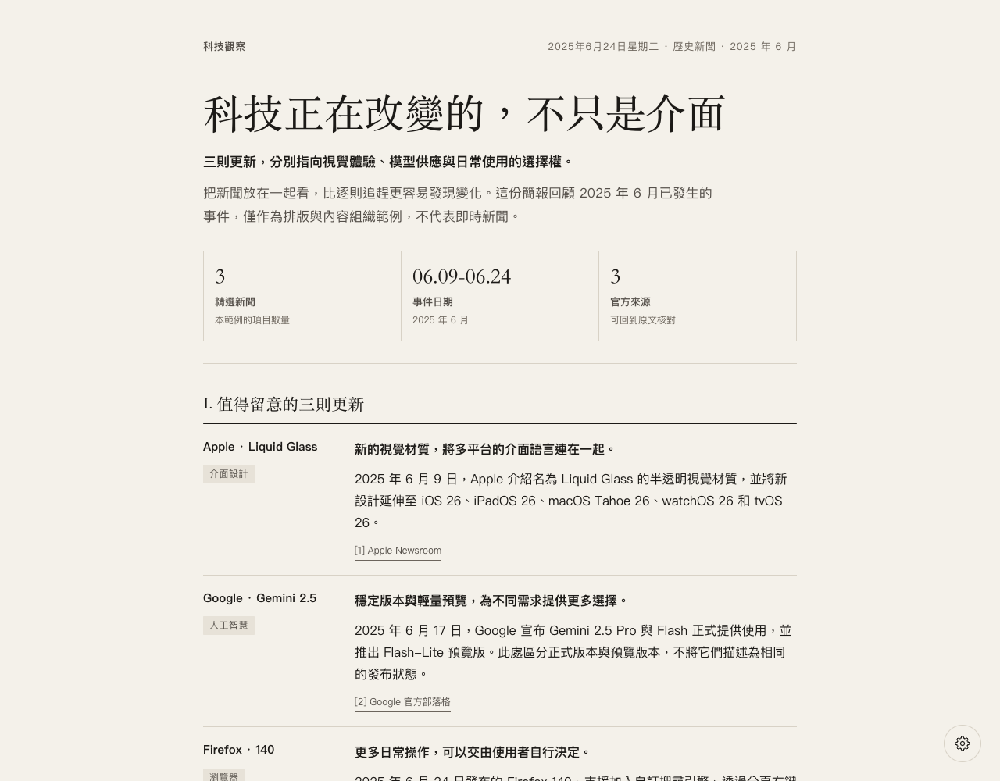
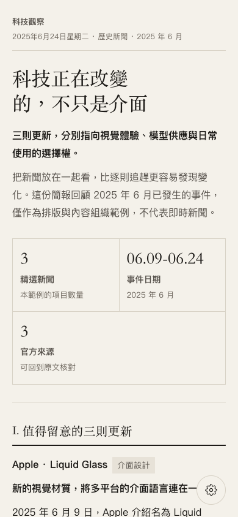
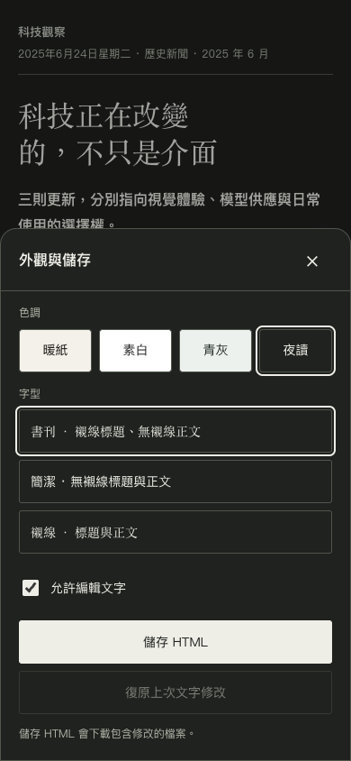
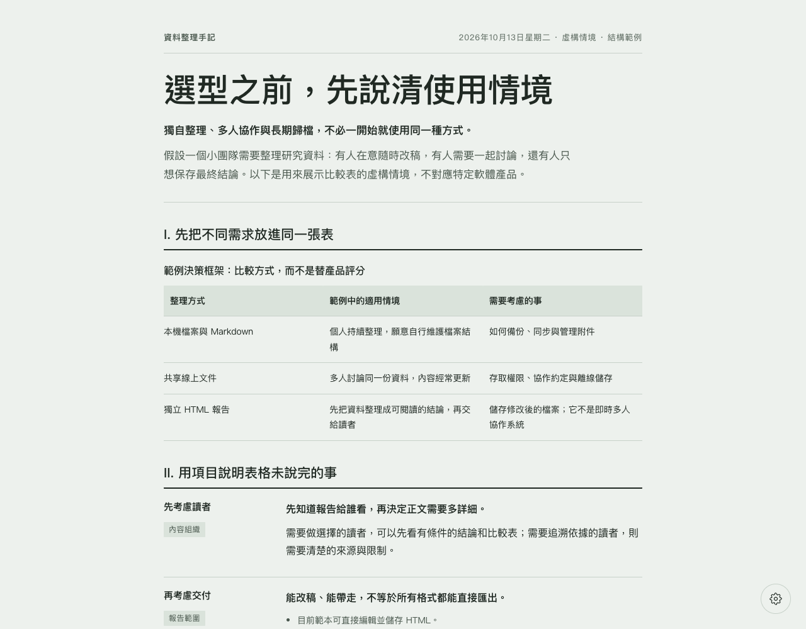
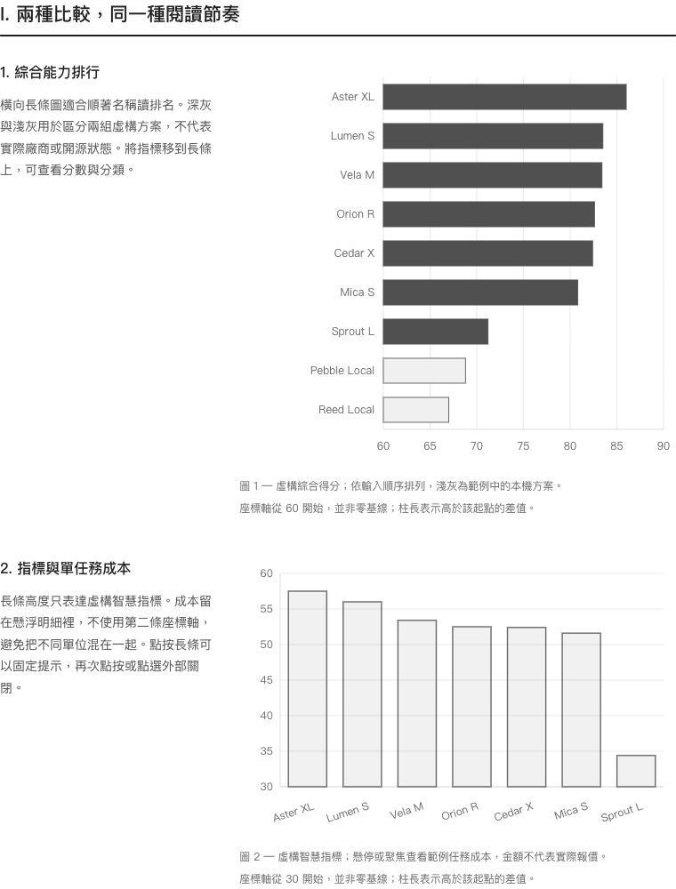
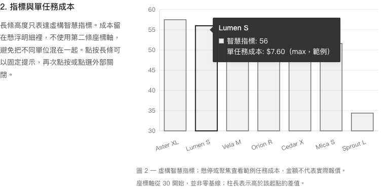
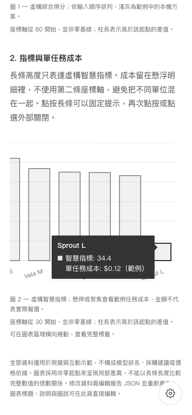

<p align="center">
  <picture>
    <source media="(max-width: 640px)" srcset="docs/images/zh-TW/readme-header-mobile.svg">
    
  </picture>
</p>

<h1 align="center">Dia 風格報告</h1>

<p align="center">
  從一個問題，到一份有主線的報告。<br>
  <sub>單檔 HTML · 直接編輯 · 桌面與手機閱讀</sub>
</p>

<p align="center">
  <a href="README.md">English</a>
  &nbsp; / &nbsp;
  <a href="README.zh-CN.md">简体中文</a>
  &nbsp; / &nbsp;
  <a href="README.zh-TW.md"><strong>繁體中文</strong></a>
  &nbsp; / &nbsp;
  <a href="README.ja.md">日本語</a>
</p>

<p align="center">
  <a href="#看看效果">查看效果</a>
  &nbsp; · &nbsp;
  <a href="#怎麼使用">開始使用</a>
  &nbsp; · &nbsp;
  <a href="SKILL.md">技能入口</a>
</p>

---

> **本 skill 的視覺風格仿照 Dia 瀏覽器中自動整理文件的風格。** 它是參考可觀察的排版與互動重新實作的非官方專案，不是 Dia 的官方 skill，也不是其內部實作的匯出。

將一個問題、幾則新聞或一組資料，整理成一份可直接在瀏覽器中閱讀、改稿和儲存的單檔 HTML 報告。預設採用暖紙色背景、襯線標題、細分隔線與克制的分欄配置；不需要安裝 Dia。

## 能做什麼

- **整理內容**：適合新聞簡報、工具選型、主題研究和資料歸納，先給結論，再展開依據與細節。
- **按內容選擇版型**：支援段落、分類項目、清單、比較表、來源連結，以及有可靠資料時使用的指標列。
- **互動式圖表**：橫向排名長條圖與描邊直向長條圖，支援懸停、手機點按及鍵盤查看明細；資料由 JSON 產生，不提供網頁內資料編輯面板。
- **直接編輯報告**：點選正文即可改字，可復原上一次文字修改；瀏覽器草稿與磁碟檔案是兩回事。
- **調整外觀**：提供暖紙、素白、青灰、夜讀四種色調，以及書刊、簡潔、襯線三組字型預設。
- **閱讀與帶走**：適配桌面和手機，儲存為包含目前文字與外觀的 HTML，重新開啟後可繼續編輯。

skill 負責提供內容組織規則、範本和產生腳本，**不是獨立的新聞爬蟲或 AI 服務**。搜尋與寫作依賴宿主 AI 的能力；產生器本身只讀取 JSON，不呼叫模型，也不連線。

## 看看效果

以下圖片均為本儲存庫產生頁面的實際截圖，不是 Dia 產品截圖。新聞範例選用 **2025 年 6 月已發生的歷史事件**，用於展示效果，不代表即時新聞。

編輯器現已支援英文、簡體中文、繁體中文和日文。截圖與本頁語言一致，展示繁體中文報告及編輯器介面；其他語言的報告範例見[語言版本](#語言版本)。

### 新聞簡報

暖紙色、結論開場、指標列，以及左側標籤／右側正文的配置。



範例：[HTML 成品](examples/i18n/news-brief.zh-TW.html) · [JSON 資料](examples/i18n/news-brief.zh-TW.json)

新聞內容經過簡短歸納，原始來源為 [Apple Newsroom](https://www.apple.com/newsroom/2025/06/apple-introduces-a-delightful-and-elegant-new-software-design/)、[Google 官方部落格](https://blog.google/products-and-platforms/products/gemini/gemini-2-5-model-family-expands/)和 [Firefox 發行說明](https://www.firefox.com/en-US/firefox/140.0/releasenotes/)，具體連結與事件日期也保留在報告裡。

### 手機閱讀與外觀設定

窄螢幕的項目改為單欄；右下角齒輪開啟設定，手機上以底部面板呈現。右圖展示夜讀色調。

| 手機閱讀 | 外觀與儲存 |
| --- | --- |
|  |  |

### 資料選型與比較表

同一套範本也能整理選型問題。這份虛構情境範例比較三種資料管理方式，不對應特定產品，也不是實際採購建議。



範例：[HTML 成品](examples/i18n/report-comparison.zh-TW.html) · [JSON 資料](examples/i18n/report-comparison.zh-TW.json)

截圖使用 Chromium 核心瀏覽器產生；手機圖為 390px 檢視區模擬，不等同於實際手機或 Safari 驗證。系統字型會隨裝置而變。

### 互動式長條圖

桌面採用左側說明、右側圖表；手機改為上下排列。懸停或聚焦可展開深色提示框；點按、Enter 或空白鍵可固定或關閉，Escape 或點選外部可關閉。密集標籤只在圖表區域橫向捲動，不撐寬整頁。



將指標移到長條上，即可顯示對象名稱、精確指標及附加的任務成本，不需增加第二條座標軸：



<details>
<summary>查看手機效果：點按顯示明細，只在圖表內橫向捲動</summary>



這是 390px 檢視區模擬，不等同於實際手機或 Safari 驗證。

</details>

範例：[互動 HTML](examples/i18n/chart-comparison.zh-TW.html) · [JSON 資料](examples/i18n/chart-comparison.zh-TW.json)。**全部名稱、分數及成本均為虛構，不是已核驗的模型排名或價格。** README 圖片是靜態截圖；請在本機開啟 HTML 體驗互動。

```bash
python3 scripts/render_report.py \
  --input examples/i18n/chart-comparison.zh-TW.json \
  --output output/chart-comparison.zh-TW.html \
  --theme white --font modern
```

數值及明細需修改 JSON 後重新產生；標題、說明及圖說可直接編輯。非零起點會明確提示。儲存 HTML 保留完整離線互動；列印保留靜態圖表，不包含僅在提示框中顯示的明細。

## 怎麼使用

### 1. 讓 AI 使用這個 skill

在可以讀取本機檔案並執行 Python 的 AI 工具中，先讓它讀取儲存庫根目錄的 [SKILL.md](SKILL.md)，再說明你的問題、資料和輸出要求：

```text
請讀取目前儲存庫的 SKILL.md，
把我提供的新聞連結整理成一份繁體中文科技簡報。
先提煉共同主線，再按主題分組，保留來源與事件日期，
產生適合手機閱讀、可以直接編輯的 HTML。
```

若已將 skill 安裝到支援技能探索的宿主，Codex CLI／IDE 可用 `$dia-style-report` 明確呼叫；支援技能選擇器的介面，也可以選擇目前顯示名稱 `Dia Style Report`。

```text
$dia-style-report 用繁體中文把這幾篇文章整理成一份主題研究報告，
先給結論，再列依據與限制；不要為了版面編造數字。
```

```text
$dia-style-report 用繁體中文比較這三個工具：
按使用情境、主要差異和移轉成本整理表格，
明確說明什麼條件下適合選哪個，最後產生 HTML 報告。
```

請在請求中明確指定報告的輸出語言。指定語言優先於 skill 說明、範例和來源資料的語言；AI 應以該語言撰寫正文，並設定對應的編輯器語言，不能只切換介面而不翻譯內容。修改既有報告時，未要求換語言就保留原語言；新報告未指定輸出語言時預設英文。

```text
$dia-style-report 把這些英文資料整理成繁體中文 HTML 報告。
標題、正文、表格標籤和編輯器介面使用繁體中文，
保留專有名稱、來源連結與事件日期。
```

安裝時保留完整目錄，不要只複製 `SKILL.md`。依照 [OpenAI 官方技能文件](https://learn.chatgpt.com/docs/build-skills)，Codex 的使用者層級位置是 `~/.agents/skills/dia-style-report/`，專案層級位置是目標專案的 `.agents/skills/dia-style-report/`。兩者擇一；已有同名目錄時不要直接覆寫。其他工具依各自的技能目錄慣例安裝。

### 2. 不用 AI，直接產生範例

需要 Python 3，產生器僅使用標準函式庫。以下指令在儲存庫根目錄執行：

```bash
python3 scripts/render_report.py \
  --input examples/i18n/news-brief.zh-TW.json \
  --output output/news-brief.html
```

用瀏覽器開啟產生的 `output/news-brief.html` 即可。輸出目錄會自動建立。

更換色調與字型：

```bash
python3 scripts/render_report.py \
  --input examples/i18n/report-comparison.zh-TW.json \
  --output output/report-comparison.html \
  --theme sage \
  --font modern
```

色調參數為 `paper|white|sage|night`，字型參數為 `editorial|modern|serif`。預設拒絕覆寫同名檔案；確認需要覆寫時才加 `--force`。自己的資料可依照 [資料規格](references/report-data.md)填寫 JSON。

**選擇報告語言**

新報告預設英文。在 JSON 中將 `language` 設為 `en`、`zh-CN`、`zh-TW` 或 `ja`，也可透過 `--language` 覆寫編輯器語言。按鈕、提示、日期和字型堆疊隨語言調整。**這不會自動翻譯正文**：請讓 AI 依指定語言寫作，或提供已翻譯的 JSON。

```bash
python3 scripts/render_report.py \
  --input examples/i18n/news-brief.zh-TW.json \
  --output output/news-brief.zh-TW.html \
  --language zh-TW
```

### 3. 修改並儲存

1. 開啟 HTML，點選標題或正文改字。
2. 點選右下角齒輪，切換色調、字型，或關閉文字編輯。
3. 點選介面上的 **儲存 HTML**，下載包含目前修改的檔案。

瀏覽器不會自動寫回原 HTML。草稿依賴目前瀏覽器的本機儲存空間，不能取代下載儲存；儲存空間不可用時仍可編輯和下載。

**目前匯出範圍**：直接儲存 HTML；PDF 可透過瀏覽器「列印 → 儲存為 PDF」，分頁和背景受瀏覽器設定影響；尚無專門的 PDF 或 Markdown 匯出按鈕。

## 語言版本

英文為儲存庫預設首頁；頁首語言導覽可切換其他版本。各版本保留相同的能力範圍、限制、使用步驟與聲明。

| 語言 | 檔案位置 | 狀態 |
| --- | --- | --- |
| English | [README.md](README.md) | 主要／預設版本 |
| 简体中文 | [README.zh-CN.md](README.zh-CN.md) | 簡體中文版本 |
| 繁體中文 | [README.zh-TW.md](README.zh-TW.md) | 目前版本 |
| 日本語 | [README.ja.md](README.ja.md) | 日文版本 |

每種語言均提供新聞簡報、比較報告、互動圖表範例和對應 JSON。請下載 HTML 或在本機開啟；GitHub 顯示的是 HTML 原始碼，不會直接執行報告。英文範例使用不帶語言後綴的檔名。

| 報告語言 | 新聞簡報 | 比較報告 | 互動圖表 |
| --- | --- | --- | --- |
| English | [HTML](examples/news-brief.html) · [JSON](examples/news-brief.json) | [HTML](examples/report-comparison.html) · [JSON](examples/report-comparison.json) | [HTML](examples/chart-comparison.html) · [JSON](examples/chart-comparison.json) |
| 简体中文 | [HTML](examples/i18n/news-brief.zh-CN.html) · [JSON](examples/i18n/news-brief.zh-CN.json) | [HTML](examples/i18n/report-comparison.zh-CN.html) · [JSON](examples/i18n/report-comparison.zh-CN.json) | [HTML](examples/chart-comparison.zh-CN.html) · [JSON](examples/chart-comparison.zh-CN.json) |
| 繁體中文 | [HTML](examples/i18n/news-brief.zh-TW.html) · [JSON](examples/i18n/news-brief.zh-TW.json) | [HTML](examples/i18n/report-comparison.zh-TW.html) · [JSON](examples/i18n/report-comparison.zh-TW.json) | [HTML](examples/i18n/chart-comparison.zh-TW.html) · [JSON](examples/i18n/chart-comparison.zh-TW.json) |
| 日本語 | [HTML](examples/i18n/news-brief.ja.html) · [JSON](examples/i18n/news-brief.ja.json) | [HTML](examples/i18n/report-comparison.ja.html) · [JSON](examples/i18n/report-comparison.ja.json) | [HTML](examples/i18n/chart-comparison.ja.html) · [JSON](examples/i18n/chart-comparison.ja.json) |

## 儲存庫內容

| 位置 | 用途 |
| --- | --- |
| [SKILL.md](SKILL.md) | 技能入口與內容組織規則 |
| [assets/report-template.html](assets/report-template.html) | 內嵌樣式、編輯與儲存互動範本 |
| [assets/locales.json](assets/locales.json) | 嵌入每份報告的共用介面翻譯 |
| [scripts/render_report.py](scripts/render_report.py) | JSON 驗證與 HTML 產生器 |
| [references/](references/) | 資料規格與設計參考 |
| [agents/openai.yaml](agents/openai.yaml) | 顯示名稱與預設呼叫提示 |
| [examples/](examples/) | 可重現的範例資料與 HTML 成品 |
| [docs/images/](docs/images/) | 實際頁面截圖與 README 頭部素材 |
| [tests/](tests/) | 既有產生器與介面語言回歸測試 |

## 開源與授權說明

本儲存庫提供可檢查的技能說明、範本、產生腳本與範例，方便了解實作方式。

**目前授權條款待確定，儲存庫尚未附帶 `LICENSE`。** 原始碼可見不代表已依某項開源授權條款提供授權；本 README 不擅自授予複製、散布或商用許可。正式開源發布前需補充明確的授權條款，後續授權範圍以 `LICENSE` 或權利人的明確授權為準。

新聞來源及其他第三方內容的權利，不會因本專案的授權條款而轉移，也不屬於本專案可以代為授權的範圍。

## 防侵權與非官方聲明

- **設計參考不等於官方關係**：Dia 名稱僅用來說明風格來源；本專案與 Dia 無官方合作、隸屬或背書關係，不應包裝成其官方產品。
- **不主張第三方權利**：Dia 及文中其他品牌的名稱、商標、專有程式碼、圖片等權利歸各權利人所有；本專案不提供這些資源的使用授權。
- **展示內容有明確來源**：README 截圖來自本專案產生的頁面；新聞以自行歸納的短文和來源連結呈現，不轉載新聞全文或第三方配圖。
- **發布前檢查素材與事實**：使用者應核對輸入資料、引用素材與產生內容，取得必要授權，避免洩露隱私，或將範例、編輯判斷誤標為事實及官方聲明。
- **尊重權利人回饋**：如認為某項內容涉及權利問題，請向專案維護者或發布平台提供具體位置與權屬依據，以便核查並修正或移除。

本聲明不能取代實際的授權審查，也不構成對「絕無侵權」的保證。
